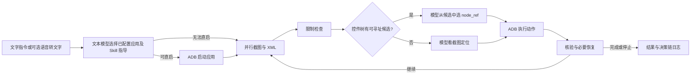

# AutomotiveGUI

AutomotiveGUI 是 CART Q3 AI 大赛的 Android Automotive GUI Agent 原型。Agent 在 PC 上理解任务并决策，通过 ADB 观察和操作车机**中控主屏**。当前实现采用章程 §4.4 的**路径 C：优先使用 UIAutomator 控件树，树不可用时使用截图交给视觉模型定位**。

例如输入“打开美团外卖 App，搜索兰州拉面，把第一家店的招牌菜加入购物车”，Agent 会尝试按当前设备缓存的包名直启应用，随后逐步观察、选择动作、执行并核验。控制台与本地页面实时显示决策链；任务结果仍应以屏幕和日志证据核对。

## 交付入口

| 章程交付物 | 本仓库位置 |
|---|---|
| 1. 完整代码及依赖 | [Agent 主程序](server/autogui/main.py)、[ADB 桥接层](server/autogui/autogui/bridge/adb.py)、[依赖清单](server/autogui/requirements.txt) |
| 2. README | 本页 |
| 3. 设计文档 | [设计文档](doc/设计文档.md) |
| 4. 验收标准自述 | [验收标准自述](doc/验收标准自述.md) |
| 7. 队伍分工说明 | [队伍分工说明](doc/队伍分工说明.md) |

交付物 5（完整决策链日志样例）、6（不超过 3 分钟的 Demo 视频）需在最终提交时补齐并在本表增加链接；本页不以示意内容冒充实际验收材料。赛制原文见[章程 v1.1a](doc/CART%20Q3%20AI%20大赛章程%20v1.1a.md)。

## 快速上手（Windows PowerShell）

### 依赖

- Windows PC、Python 3.10+、可访问模型服务的网络。
- 已开启 USB 调试的 Android Automotive 车机；安卓手机可用于链路冒烟测试，不能代替车机验收。只操作中控主屏。
- ADB（仓库内有 `env/platform-tools/adb.exe`）；目标设备在 `adb devices` 中应显示 `device`。
- 模型服务 URL、模型名称和 API Key。语音输入是可选功能，需另配讯飞凭证及语音依赖。
- Python 包版本范围见[requirements.txt](server/autogui/requirements.txt)；主要依赖 LangGraph、OpenAI 兼容客户端、Pillow、PyYAML、Pydantic 与 MCP。

从仓库根目录执行：

```powershell
$env:Path = (Join-Path (Get-Location) 'env\platform-tools') + ';' + $env:Path
adb devices -l
Set-Location server\autogui
py -3 -m venv .venv
.\.venv\Scripts\python.exe -m pip install -r requirements.txt
.\.venv\Scripts\python.exe main.py --selftest
.\.venv\Scripts\python.exe main.py --check
```

`--selftest` 不需要设备和 API Key；`--check` 检查 ADB、截图、控件树、输入策略及当前设备上配置的应用，不请求模型 API。首次连接必须在设备上同意 USB 调试授权。若电脑没有 `py`，改用 `python` 创建虚拟环境。完整部署与故障处理见[部署与联调手册](doc/部署与联调手册.md)。

### 配置与运行

在仓库根目录运行 `start.bat`，按 **F** 前台启动（控制台实时日志，`Ctrl+C` 停止）或按 **B** 后台启动（用 `stop.bat` 停止）。打开 `http://127.0.0.1:8777/` 输入任务；在 `/settings` 填写模型 URL、模型名称、API Key 并点击“验证连接”，再为当前设备重新加载需要操作的应用包名。设置页保存的密钥由本机 Windows DPAPI 加密；换机器须重新录入。

也可从 `server/autogui` 目录直接运行：

```powershell
.\.venv\Scripts\python.exe main.py "在 QQ 音乐里播放我爱你中国"
.\.venv\Scripts\python.exe main.py "打开美团外卖 App，搜索兰州拉面，把第一家店的招牌菜加入购物车"
```

CLI 可使用设置页保存的本机配置，也可通过当前进程环境变量 `GLM_API_KEY` 提供密钥。`--packages` 列出设备包名，`--dump-report` 检查目标应用的控件树质量，`--mcp-check` 检查可选 MCP 执行通道。实际可操作应用以比赛车机镜像和当前设备安装情况为准。

## Agent 如何工作



Skill 在普通自然语言任务中是**给模型的操作指导**，不会因为命中名称就自行执行 YAML `steps`。`--skill-only` 是独立的显式配方调试入口。详细的 Agent 组织、Context 分层、限制与降级机制见[设计文档](doc/设计文档.md)。

## 实时日志与排障

任务运行时控制台打印 `perceive → route → decide → act → verify` 等阶段，页面 `/logs` 可回看。每条任务写入 `server/autogui/artifacts/logs/*.jsonl`；`debug: true` 时另保存截图、XML、模型请求与响应。日志里的 `in_tok/out_tok` 来自模型返回用量；`≈in` 仅是发送前裁剪上下文的估计。

开始排查时先看 `--check`，然后查看同一步的 XML 状态、tree 候选、模型响应与执行后画面。XML dump 超时或控件不可寻址会进入视觉兜底；成功抓到 XML 不等于页面一定有可点击候选。详见[代码流程与联调日志导读](doc/代码流程与联调日志导读.md)。

## 已知限制

- 比赛范围限车机中控主屏及镜像内应用；手机验证仅覆盖技术链路，屏幕比例与包名可能不同。
- WebView、自绘页面或广告页可能返回空树、无标签树或 XML 超时；视觉定位通常增加耗时与 token。
- 中文输入取决于设备允许的输入方式；当前实现依次尝试已配置输入链并检查输入法恢复。
- 登录、验证码、支付、下单等界面可能需要人工处理或明确授权；“加入购物车”不等于“提交订单”。
- 首次部署需在设置页验证模型连接和当前设备应用包名；旧设备缓存不能直接用于新设备。
- `--check` 只验证环境，任务是否完成须看实际操作结果和决策链证据。

## 项目结构

| 位置 | 作用 |
|---|---|
| [`server/autogui/autogui/core/`](server/autogui/autogui/core/) | LangGraph 主循环、限制、核验、恢复与决策链 |
| [`server/autogui/autogui/perception/`](server/autogui/autogui/perception/) | 截图、XML 候选与屏幕指纹 |
| [`server/autogui/autogui/brain/`](server/autogui/autogui/brain/) | 模型调用、提示词与上下文 |
| [`server/autogui/autogui/bridge/`](server/autogui/autogui/bridge/) | ADB、输入及设备工具 |
| [`server/autogui/skills/`](server/autogui/skills/) | 应用任务指导与页面经验 |
| [`dist/dashboard_server.py`](dist/dashboard_server.py) | 本地任务、日志和设置页面 |
