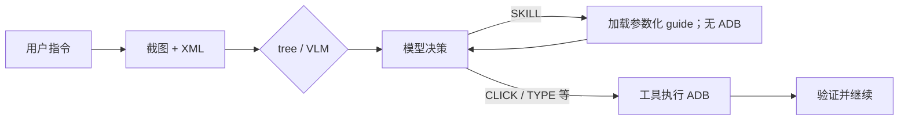

# skills 技能层技术文档

> 对应代码：`server/autogui/autogui/skills/base.py`、`server/autogui/skills/<app>/skill.yaml`。比赛要求以章程原文为准，本文只说明当前实现。

## 一句话理解

普通任务中的 Skill 是**给大模型的操作指南**。用户输入指令后，系统先抓截图和 XML，按树质量选 tree/VLM 并调用模型。模型认为任务的应用和目标都匹配某项技能时，才返回 `SKILL`；`core.run_skill()` 加载该技能的 `guide`，然后在同一张观察上再次调用模型。加载指南不会点击、输入或直接标记完成。



`--skill-only` 是另一个显式入口：它调用 `SkillBook.run()` 顺序执行 YAML 的 `steps`，用于单独调试旧配方。外部 MCP 的 `run_skill` 工具也走该执行器。普通自然语言任务不调用它。

## YAML 的两部分

```yaml
name: music
app: {package: ""}
skills:
  - name: play_song
    summary: 在音乐 App 搜索指定歌曲并播放
    params: [song]
    guide: |
      适用于用户明确要求在音乐应用播放歌曲 {song}。
      根据当前页面寻找搜索入口和目标歌曲，看到播放证据后才完成。
    steps:
      - {act: launch}
      - {act: click, hint: {text: "搜索"}}
```

- `summary` 和参数签名进入模型的**技能索引**；有 `guide` 的技能才会出现在索引里。
- `guide` 只在模型选中 Skill 后进入 Context，`{song}` 等参数会替换为模型给出的值。模型随后按屏幕逐步操作。指南在本次任务后续决策里持续携带，当前还没有自动清退机制。
- `steps` 只供显式配方入口执行。里面的 `hint` 通过新抓的 XML 按 `text` / `desc` / `rid` 匹配节点；它们没有被发送给普通任务的模型。
- 包名为空或 hint 占位会影响显式配方，普通指南仍可加载。指南里的应用范围必须写清楚，避免把跨 App 的相似任务引向错误流程。

## 关键代码与限制

1. `Runner.prepare()` 加载 `SkillBook`，将 `SkillBook.index()` 放入 `Context.skill_index`。
2. 每轮 `perceive()` 抓取屏幕；`route()` 只选 tree/VLM，没有关键词匹配。
3. `brain/prompts.py` 提醒模型：应用和目标同时匹配、参数能确定时才选 `SKILL`。
4. `Runner.decide()` 校验技能存在、有指南、参数齐全、当前任务尚未加载此技能；同一步最多加载一次，避免循环。
5. `Runner.run_skill()` 调用 `SkillBook.guidance()`，把指南写入 `Context.active_skill_guide`，回到原 tree/VLM 路线再次决策。此节点不操作设备。
6. 真实 ADB 操作由下一次模型回答的普通动作经 `act()` 执行，随后 `verify()` 检查。

这仍不是完全防误触：模型可能误判应用或意图；但误选只会增加一份指南和一次模型调用，不会立即运行配方。显式 `--skill-only` 仍需在目标设备上校准包名和 hint，并由调用者确认任务适用性。当前 `SkillBook.get()` 支持唯一短名解析；普通提示词要求全名 `app.name`，方便日志追踪。

## 观察日志

正常模型选中 Skill 时，决策链会记录“模型选择技能 … → 加载指导，不执行配方”和“加载 … 指导；未执行 ADB”。紧随其后的 GLM 请求应含参数化指南，GLM 响应应是具体动作。若看到 ADB 操作，应追溯该动作所在的 `act` 记录，而不是将加载指南视为执行。详细顺序见[代码流程与联调日志导读](../doc/代码流程与联调日志导读.md)。
