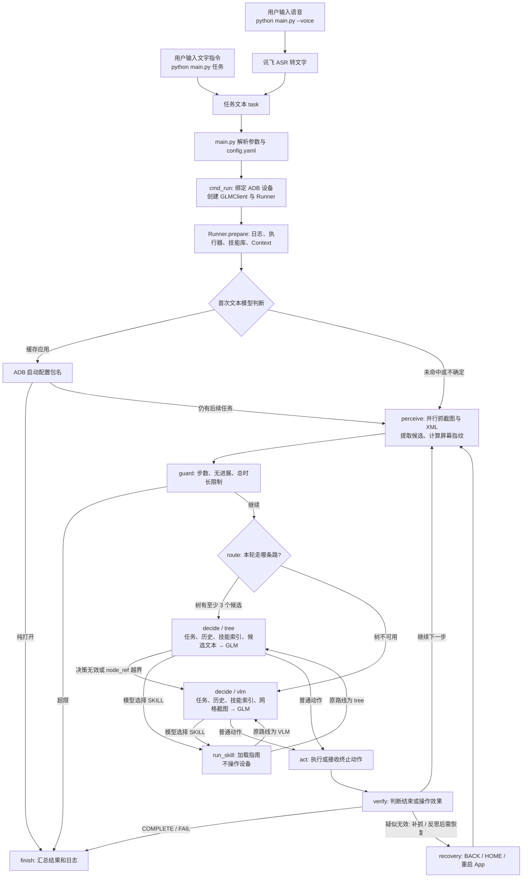

# AutomotiveGUI 代码流程与联调日志导读

本文依据当前代码整理；比赛要求以 `CART Q3 AI 大赛章程 v1.1a.md` 为准。即使暂时没有设备，也可以先用下图理解一条指令如何流转；接通设备后再对照日志核验。

## 从输入指令到结束：完整主线

**`decide` 不是入口。** 用户先输入文字，或用 `--voice` 将语音识别成文字；`main.py` 绑定 ADB 设备并创建 `Runner`。`Runner.prepare()` 加载技能库、执行器和日志。随后一次纯文本模型判断可否打开已配置应用：命中则先 ADB 启动，纯打开任务结束；否则进入 LangGraph 的 `perceive`，逐轮走 tree 或 VLM。



图中的 `--skill-only` 是另一个显式入口：它在 `cmd_run()` 中直接调用 `SkillBook.run()`，跳过 `Runner` 和 LangGraph，适合单独调试配方，不代表普通自然语言任务的控制流。`--check`、`--packages` 等是自检命令，也不进入该图。

代码定位：入口和 ASR 分别是 `server/autogui/main.py::main` / `cmd_voice` / `cmd_run`；图定义是 `autogui/core/graph.py::Runner.graph`；观察是 `perception/capture.py::observe`；设备操作经 `bridge/tools.py`、`bridge/adb.py`。`AgentState` 只放步数、路由、动作和结束标记等小字段，截图、XML、Context 与技能库留在 `Runner` 上。

### 跟着一条指令走

以「在音乐 App 播放某首歌」为例：

1. `main.py` 把命令行文字作为 `task`；若使用 `--voice`，先经 ASR 得到同样的 `task`。
2. `cmd_run()` 绑定设备并创建 `GLMClient`、`Runner`；`prepare()` 建立技能索引和日志。
3. 首次文本模型判断是否可打开缓存应用；若命中则先 ADB 启动。仍需操作界面时，`perceive()` 抓当前屏幕和 XML，`guard()` 确认还可继续。
4. `route()` 用 XML 候选决定 tree 是否可用，否则选择 VLM；关键词不触发设备动作。
5. `decide()` 看当前屏幕信息并回答**一个**动作。若回答 `SKILL`，`run_skill()` 仅加载指南，模型随后结合指南再次决策。模型给出普通动作后由 `act()` 执行，`verify()` 结算，再观察下一轮。

## Skill、XML、VLM 到底怎么选

1. **首次判断不观察。** 只把任务与应用名称/别名发给模型；命中缓存时先 ADB 启动。进入界面操作后，`perceive()` 并行抓截图与 XML，候选数至少 **3 个**时认为树可用。
2. **XML 优先。** 树可用时走 `tree`：`Context.trim()` 生成任务、技能索引、历史和当前候选的文本；模型回答 `node_ref` 等动作。`node_ref` 越界或模型决策报错时，本轮改走 `vlm`，最多重新决策一次。
3. **网格截图兜底。** 树不可用时走 `vlm`：在截图上画网格，发给 GLM；模型可以用 `grid` 定位。此处仍带任务、历史、技能索引等文本上下文。
4. **模型可选择 Skill。** 模型根据任务、应用和当前页面选择 `SKILL(name, params)`；`run_skill()` 校验参数并把对应 `guide` 放入 Context，**此时不发 ADB 操作**。随后回到原 tree/VLM 路线再问模型，具体点击、输入和完成判断仍由模型逐步决定。未知或重复的选择不执行配方。

**Skill 是否每轮都当 prompt？** `SkillBook.index()` 在 `prepare()` 时生成一行一个技能的简短清单。每次决策模型调用都会带清单，尚未选择时不会带完整指南。模型选择 `SKILL` 后，该技能的 `guide` 加入永久上下文，后续决策调用都会带上，直到任务结束；YAML 的 `steps` 不进入普通任务的模型请求。这个常驻指南会增加 token，后续可评估按页面或阶段清退。

当前代码还有几处值得下一轮整改：指南选择仍依赖模型判断，可能选择不合适的技能，不过不会因此直接执行配方。显式 `--skill-only` 的配方执行完会直接生成 `COMPLETE`，没有针对用户目标的独立完成判定。另外，`perceive()` 抓帧失败返回的 `done=True` 可能被随后 `guard_node()` 返回的 `done=False` 覆盖。

## 用安卓手机联调

在 `server/autogui` 目录执行；手机需要打开 USB 调试，`adb devices` 显示 `device`。当前 `config.yaml` 已设 `debug: true`。

```powershell
cd H:\project\github\AutomotiveGUI\server\autogui
.\.venv\Scripts\python.exe main.py --check
.\.venv\Scripts\python.exe main.py "打开设置，查看蓝牙状态"
```

手机上可以先用简单、无下单/发送动作的指令。测试前检查 `config.yaml` 中的 `apps` 包名是否存在于手机；车机 App 包名通常不能直接用于手机。也可先运行 `main.py --packages`。任务执行不要求技能命中；没有合适包名时可走通用 tree/VLM 路径。

每次任务会在 `server/autogui/artifacts/logs/` 生成一个 `.jsonl` 决策链和同名子目录。控制台与 JSONL 显示 `Step`、阶段、路由与耗时；子目录保存诊断材料：

| 文件/事件 | 看什么 |
|---|---|
| `stepNN_screenshot.png` | 本轮原始屏幕 |
| `stepNN_####_xml.xml` | **每一次** `uiautomator dump` 的完整 XML；技能和补抓的 XML 也记录 |
| `stepNN_candidates.txt` | 裁剪后送给 tree 决策的完整文本上下文 |
| `stepNN_grid.jpg` | VLM 决策时的网格截图 |
| `stepNN_####_glm_request.json` | 完整请求文本、模型参数及图片所在位置；图片 base64 用占位说明，实际图见 `.jpg` |
| `stepNN_####_glm_response.json` | 模型原始回复，尚未解析成动作 |
| `stepNN_reflect_before.jpg` / `after.jpg` | 反思调用的前后图片 |

`####` 是本任务递增的文件序号；同一次 GLM 请求/响应在 JSONL 里共享 `call_id`。XML 的 `status` 和 `dump_ms` 也在 JSONL 中。建议按 `Step → route → glm_request/response → skill guide（如选择）→ glm_request/response → act → verify` 阅读；普通流程的 `skill` 事件只表示加载指南，后续 ADB 动作由模型决策产生。显式 `--skill-only` 才会看到配方步骤的 XML 与执行日志。

诊断目录包含屏幕内容、用户任务和完整模型文本，可能出现账号、消息或输入内容；目录已被 `.gitignore` 排除，分享前请检查并脱敏。当前日志是观察实际行为的工具，不代表安卓手机测试结果可直接推断车机表现。
