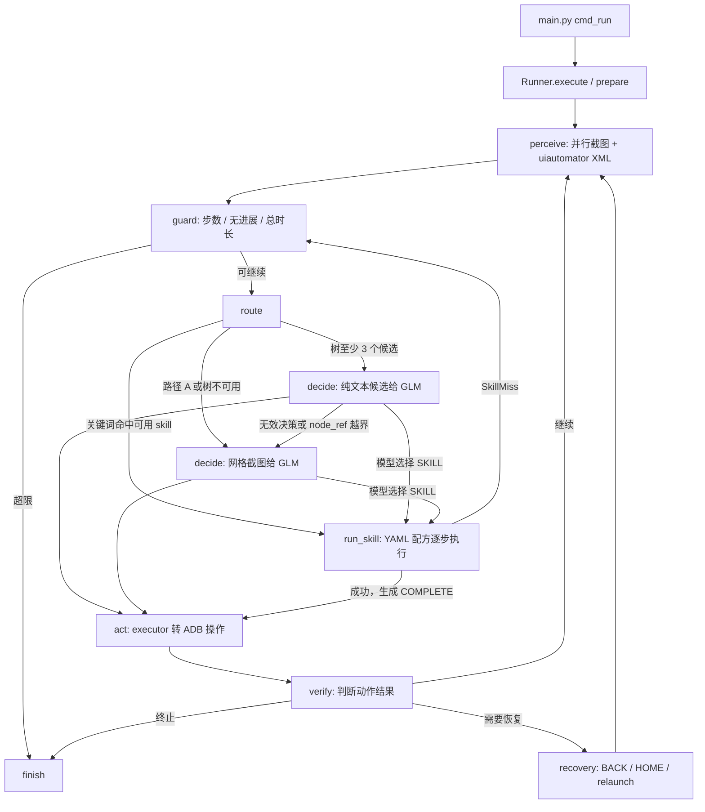

# AutomotiveGUI 代码流程与联调日志导读

本文依据当前代码整理；比赛要求以 `CART Q3 AI 大赛章程 v1.1a.md` 为准。它适合先用安卓手机跑一条普通指令，再对照日志逐步看控制流。

## 先抓住一条主线

`main.py` 绑定 ADB 设备并创建 `GLMClient`、`Runner`。`Runner.execute()` 初始化日志与技能库，调用 LangGraph。图的状态 `AgentState` 只放步数、路由、动作、结束标记等小字段；截图、XML、上下文和技能库放在 `Runner` 对象上。



入口和图定义：`server/autogui/main.py::cmd_run`、`autogui/core/graph.py::Runner.execute` / `Runner.graph`。观察：`perception/capture.py::observe`。实际设备操作：`bridge/tools.py`、`bridge/adb.py`。

## Skill、XML、VLM 到底怎么选

1. **每轮都先观察。** `perceive()` 同时抓截图与 XML；`tree.candidates_from_xml()` 把 XML 压缩成有编号的候选。`Observation.tree_usable` 的真实条件是候选数 **至少 3 个**。
2. **路由先试关键词技能。** 仅当 `declared_path` 是 B/C、`skills.enabled=true`、任务触发词命中、技能包名已配置、技能失败次数未到 2 次时，`route()` 返回 `skill`。`run_skill()` 直接执行 YAML 配方；这里**不调用模型**。点击步骤按 hint 的 `text` / `desc` / `rid` 重新抓 XML 找节点，然后点其中心。发生 `SkillMiss` 后会回到 `guard → route`；同一技能至多尝试两次，之后才进入 tree/VLM。
3. **再试 XML 候选。** B/C 且树可用时走 `tree`：`Context.trim()` 生成任务、技能索引、历史和当前候选的文本；`GLMClient.decide()` 只收到文本，模型回答 `node_ref` 等动作。`node_ref` 越界或模型决策报错时，本轮改走 `vlm`，最多重新决策一次。
4. **最后是网格截图。** 路径 A 或树不可用时走 `vlm`：在截图上画网格，发给 GLM；模型可以用 `grid` 定位。此处仍会带任务、历史、技能索引等文本上下文。

**Skill 是否每轮都当 prompt？** `SkillBook.index()` 在 `prepare()` 时生成一行一个技能的简短清单，放入 `Context.permanent_block()`。每次**真正调用决策模型**，都会通过 `Context.trim()` 将这份清单放进请求。模型看到的是技能签名与说明，**不是完整 YAML 步骤**；它可以回答 `SKILL` 动作，图再调用 `run_skill()`。关键词直接命中技能时根本不发生这轮决策模型调用。技能失败次数耗尽后，清单会刷新并标记失效。

当前代码有两处值得下一轮整改：`declared_path=B` 在树不可用时也会走 VLM，所以 B/C 在这段代码中的降级行为并无严格区分；路径 A 虽然不做关键词技能路由，模型提示词里仍有技能清单，也可能由模型选择技能。另一个风险是配方执行完直接生成 `COMPLETE`，没有针对用户目标的独立完成判定。这里先保持现有行为，便于通过日志收集证据后再改。

## 用安卓手机联调

在 `server/autogui` 目录执行；手机需要打开 USB 调试，`adb devices` 显示 `device`。当前 `config.yaml` 已设 `debug: true`。

```powershell
cd H:\project\github\AutomotiveGUI\server\autogui
.\.venv\Scripts\python.exe main.py --check
.\.venv\Scripts\python.exe main.py "打开设置，查看蓝牙状态"
```

手机上可以先用简单、无下单/发送动作的指令。测试前检查 `config.yaml` 中的 `apps` 包名是否存在于手机；车机 App 包名通常不能直接用于手机。也可先运行 `main.py --packages`。任务执行不要求技能命中；没有合适包名时可走通用 tree/VLM 路径。

每次任务会在 `server/autogui/artifacts/logs/` 生成一个 `.jsonl` 决策链和同名子目录。控制台与 JSONL 显示 `Step`、阶段、路由与耗时；子目录保存诊断材料：

| 文件/事件 | 看什么 |
|---|---|
| `stepNN_screenshot.png` | 本轮原始屏幕 |
| `stepNN_####_xml.txt` | **每一次** `uiautomator dump` 的完整 XML；技能和补抓的 XML 也记录 |
| `stepNN_candidates.txt` | 裁剪后送给 tree 决策的完整文本上下文 |
| `stepNN_grid.jpg` | VLM 决策时的网格截图 |
| `stepNN_####_glm_request.txt` | 完整请求文本、模型参数及图片所在位置；图片 base64 用占位说明，实际图见 `.jpg` |
| `stepNN_####_glm_response.txt` | 模型原始回复，尚未解析成动作 |
| `stepNN_reflect_before.jpg` / `after.jpg` | 反思调用的前后图片 |

`####` 是本任务递增的文件序号；同一次 GLM 请求/响应在 JSONL 里共享 `call_id`。XML 的 `status` 和 `dump_ms` 也在 JSONL 中。建议按 `Step → route → glm_request/response → act → verify` 阅读；看到 `skill` 时，在它的 `stepN 开始/完成/失败` 事件之间找 XML 文件，便能知道 hint 对应哪一棵树。

诊断目录包含屏幕内容、用户任务和完整模型文本，可能出现账号、消息或输入内容；目录已被 `.gitignore` 排除，分享前请检查并脱敏。当前日志是观察实际行为的工具，不代表安卓手机测试结果可直接推断车机表现。
