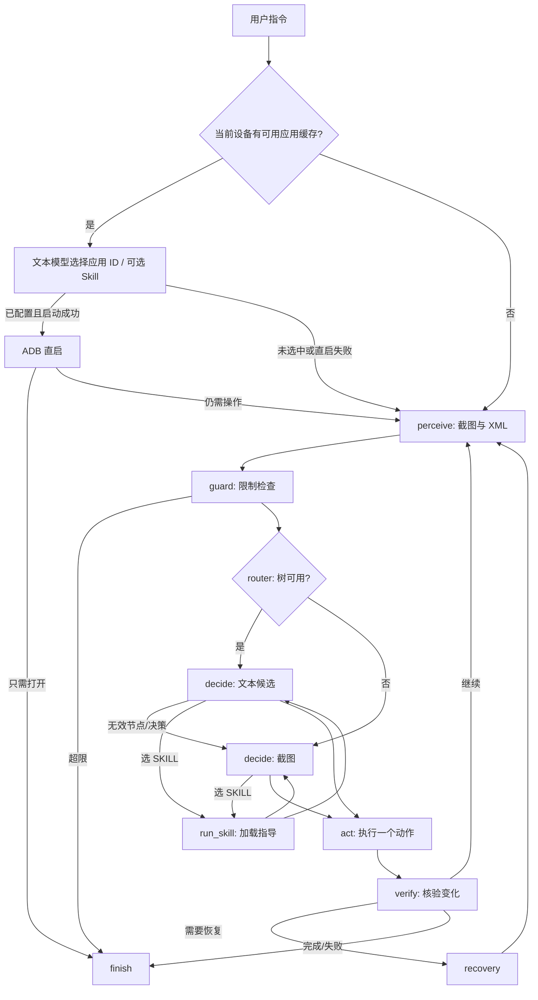

# AutomotiveGUI 设计文档

本文描述当前实现。比赛规则以[章程 v1.1a](CART%20Q3%20AI%20大赛章程%20v1.1a.md)为准；其他方案讨论文档不作为赛制依据。项目声明选择章程 §4.4 的**路径 C（控件树优先，视觉兜底）**。

## 1. 组件与执行边界

PC 运行 Agent、模型客户端、页面及 ADB 桥接；Android Automotive 设备是执行目标。设备侧通过 ADB 返回截图和 `uiautomator dump`，接收点击、滑动、输入等操作。中控主屏是比赛任务范围；`display_id` 用于多屏设备的目标屏指定。

| 层 | 当前实现 | 职责 |
|---|---|---|
| 入口 | `main.py`、`dist/dashboard_server.py` | CLI/页面提交文字任务，可选语音转文字 |
| 控制流 | `core/graph.py`、`core/state.py` | LangGraph 节点和条件边，单步动作闭环 |
| 决策 | `brain/glm_client.py`、`brain/prompts.py`、`prompt_text.yaml` | 文本或视觉模型请求，解析 JSON 动作及模型用量 |
| 感知 | `perception/capture.py`、`perception/tree.py` | 截图与 XML 采集、候选裁剪、屏幕指纹 |
| 执行 | `core/executor.py`、`bridge/tools.py`、`bridge/adb.py` | local/MCP 调度与 ADB 操作 |
| 约束与记录 | `core/guard.py`、`core/decision_log.py` | 步数/耗时/无进展限制、实时日志和 JSONL |

`exec_mode: local` 直接调用设备工具；`mcp` 通过 MCP 会话调用同一工具语义。模型只返回动作参数，实际 ADB 命令由执行层构造和校验。

## 2. Agent 组织与一次任务的流转

`graph.py` 实际定义 `perceive`、`guard`、`router`、`run_skill`、`decide`、`act`、`verify`、`recovery`、`finish` 九个节点。模型每轮给出一个动作，执行后重新观测。首次应用选择发生在进入图之前：模型只看到指令与当前设备已配置应用清单，返回应用 ID；执行层使用配置的包名直启，未命中或启动失败则观察屏幕。应用缓存按设备序列号隔离。

## 3. Skill 拆分

`server/autogui/skills/<app>/skill.yaml` 按应用和任务组织，例如 `music.play_song`、`meituan.search_and_add`。页面经验放在对应应用的 `ui_hints.yaml`，只在页面匹配时注入。通用的动作协议、点击/滚动规则属于提示词与执行器，不复制到每个应用 Skill。

普通任务中，Skill 索引先提供短摘要。首次应用选择或后续 `SKILL(name, params)` 命中时，`SkillBook.guidance()` 加载对应 `guide`，模型仍须依据当前屏幕决定下一动作；**加载 Skill 不执行 ADB，也不自动跑 `steps`**。YAML `steps` 只供显式 `--skill-only`/旧配方入口使用，找不到目标时抛 `SkillMiss`。这一拆分使应用经验可维护，同时保留页面变化时的通用观察与降级能力。

## 4. Context 分层与 token 控制

`brain/context.py` 在发送前组织四类信息：

1. **永久块**：任务、动作类型、可用应用/技能索引、已加载指导、必要输入提示。
2. **滑动历史**：最近 `history_window` 步的动作与结果，包含失败尝试，避免重复试错。
3. **关键实体**：已确认的歌曲、店铺、时间、地点等跨步骤事实。
4. **当前观察**：tree 路由的 XML 候选文本，或 VLM 路由的截图。

树候选按可操作性、标签、任务关联性与覆盖位置裁剪；静态标题若位于可点击父行，可关联为可寻址候选。当前配置约束 `tree_candidate_limit` 和 `token_budget`；预算超限时先压缩旧历史，再减少候选，保留任务与已确认实体。`estimate_tokens` 仅用于发送前裁剪；任务汇总使用模型返回的 `usage`。tree 决策不发送截图，视觉兜底才编码图片。

## 5. Harness、核验与降级

### 5.1 感知与定位

`capture.observe()` 常态并行执行 `screencap` 和 XML dump，避免把两次设备等待简单相加。树里有至少 3 个可寻址候选时优先给模型文本和 `node_ref`；树为空、超时、控件不可寻址或当前目标被候选裁剪遗漏时转 VLM。tree 决策产生无效节点时，同一步可重新用截图定位。VLM `point` 和 `DRAG.from/to` 在执行前换算成设备像素；tree 的 `coord` 使用设备像素。空 XML 与超时等状态写入日志，不能当成“界面确实无控件”。

### 5.2 动作与反馈

动作 schema 在 `actions.py` 校验；执行层经 ADB 完成点击、输入、滚动、启动等操作。`verify` 结合新旧屏幕指纹和必要的语义证据判断动作效果，不能仅凭 ADB 命令返回成功就宣布任务完成。普通列表滚动、数值滚轮 `ROLL_TO` 和拖动是不同动作。倒计时广告的旧坐标在点击前复核；启动阶段对可识别广告或 QQ 音乐无标签首帧进行等待/重抓，避免迟到点击误触底层界面。

### 5.3 限制与恢复

`guard` 检查最大步数、墙钟时限和连续无进展。异常输入、树定位失败、界面无变化等情况进入重新观察、视觉兜底或 `recovery`；恢复仍失败则结束并记录原因。XML dump 连续超时时可暂时跳过一次 XML 采集，使用截图，下一轮恢复尝试。错误不会被伪装成成功。

### 5.4 可观测性

PC 控制台与本地页面实时展示 `perceive → route → decide → act → verify`，按大步数分组；每条任务保存 JSONL。`debug: true` 额外保留原始 XML、截图、候选列表及模型请求/响应，便于复现定位和核对模型实际看到的信息。日志提供耗时、真实 token 用量、XML 状态及降级理由；不生成不存在的置信度或 Activity 证据。

## 6. 当前边界

运行时固定路径 C，不提供 A/B/C 配置切换。WebView、自绘界面和权限/广告弹窗的 XML 可能不完整；VLM 增加模型开销。应用直启只适用于当前设备已缓存的目标包名。跨应用复杂任务依赖多轮顺序观察与执行；本项目没有把两个设备动作并行发往同一屏幕。语音仅是可选的任务输入通道。具体部署步骤和环境风险见[部署与联调手册](部署与联调手册.md)。
