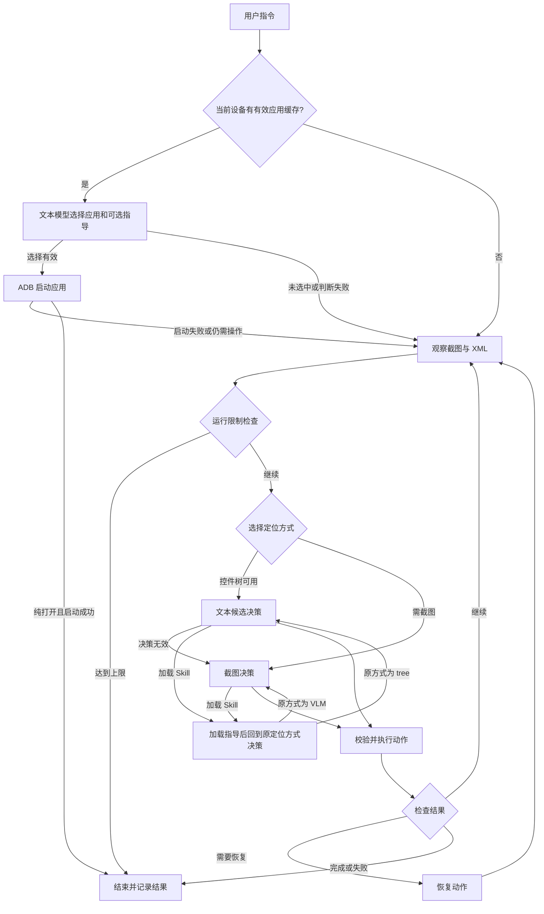

# AutomotiveGUI 设计文档

本文说明程序如何接收指令、观察中控屏、选择动作并检查结果。部署命令见《部署与联调手册》，交付内容和核验方法见《验收标准自述》。

本文位置：`doc/设计文档.md`。源码路径均相对于项目根目录，相关文档位置见文末。

项目采用路径 C：控件树优先，截图定位兜底。目标设备为大众 CEA1.3 车机中控主屏，手机用于技术链路测试。赛事应用范围和评分要求以正式章程及车机镜像为准；当前仓库未附章程原文。

## 1. 组件与执行边界

应用适配目标包括车机基础应用（如导航、音乐、电话、消息、设置、电台、车辆控制、车辆信息与能耗），以及哔哩哔哩、飞书、外卖等任务应用。最终清单以现场要求和设备实际安装情况为准；每个应用的包名、页面与输入方式都需单独核对。

电脑运行 Agent、模型客户端、网页面板和 ADB 桥接层。设备通过 ADB 提供截图与页面 XML，并接收点击、滑动、输入等命令。模型负责提出动作，执行层负责校验参数并操作设备。

| 名称 | 在项目中的含义 |
|---|---|
| Agent | 根据指令多轮观察、决策和操作的程序 |
| tree | 从 XML 提取可定位控件，再让模型选择控件编号 |
| VLM | 使用支持图像输入的模型，根据截图定位 |
| Skill | 按应用和任务组织的操作指导；普通任务加载指导后仍由模型决策 |
| Context | 单次任务中发送给模型的任务、历史、实体和当前观察信息 |
| Harness | 承载观察、执行、检查、限制和恢复等机制的运行框架 |

主要文件如下，表中的路径可从项目根目录直接查找：

| 层 | 主要文件 | 职责 |
|---|---|---|
| 入口 | `server/autogui/main.py`、`dist/dashboard_server.py` | CLI、网页任务提交与可选语音输入 |
| 控制流 | `server/autogui/autogui/core/graph.py`、`core/state.py` | 执行节点、条件分支和任务状态 |
| 决策 | `server/autogui/autogui/brain/glm_client.py`、`brain/prompts.py`、`brain/prompt_templates/` | 模型请求、独立提示词文件、动作解析与模型用量 |
| 感知 | `server/autogui/autogui/perception/capture.py`、`perception/tree.py`、`perception/image.py` | 截图/XML 采集、候选裁剪、图像编码与屏幕指纹 |
| 执行 | `server/autogui/autogui/core/executor.py`、`bridge/tools.py`、`bridge/adb.py`、`core/picker.py` | local/MCP 调度、设备操作和数值滚轮调整 |
| 约束与记录 | `server/autogui/autogui/core/guard.py`、`core/decision_log.py` | 运行上限、实时进度、JSONL 与诊断文件 |

除 `main.py` 和 `dist/dashboard_server.py` 外，表中省略前缀的文件均位于 `server/autogui/autogui/` 下。

`exec_mode: local` 在进程内直接调用设备工具；`mcp` 通过 MCP 会话调用同一批工具。MCP 初始化失败时可降级到 local。滚轮调整由专门的执行逻辑配合设备桥接层完成；设备工具会读取或操作设备。

## 2. 一次任务怎样执行

以“在音乐应用搜索并播放一首歌”为例，执行顺序如下：

1. **准备任务**：读取配置，绑定设备，初始化日志、模型客户端和任务指导。
2. **尝试选择应用**：如果应用缓存与当前设备匹配且有可用目标应用，先由文本模型选择应用 ID 和可选 Skill，执行层使用配置包名启动。无有效缓存、未选中应用或启动失败时，直接观察当前屏幕。
3. **观察并选择定位方式**：采集截图与 XML，检查运行上限，选择控件树定位或截图定位。
4. **决定下一步**：模型给出一个动作；若模型选择 Skill，先加载指导，再在当前观察上继续决策。
5. **执行与检查**：校验动作并操作设备，按配置检查效果；需要时重新观察、反思或执行恢复动作。
6. **继续或结束**：未完成则进入下一轮；完成、失败或达到运行上限时结束，并记录结果。

仅要求“打开应用”的任务，可在模型选中应用并直启成功后结束，不一定经过完整观察循环。

图是主要流程的说明，完整条件边以 `server/autogui/autogui/core/graph.py` 为准。LangGraph 定义九个节点：`perceive`、`guard`、`router`、`run_skill`、`decide`、`act`、`verify`、`recovery`、`finish`；首次应用选择发生在进入图之前。

## 3. 定位与设备操作

### 3.1 控件树优先，截图兜底

通常有至少 3 个可寻址候选时走 tree。模型收到候选文本，用 `node_ref` 指向控件，tree 决策不发送截图。

候选不足、XML 不可用、任务目标被候选裁剪遗漏或 tree 决策无效时，转为 VLM。需要观察屏幕键盘或无法从 XML 读出选中值的自定义滚轮时，也会优先使用截图。

VLM 收到的是没有网格覆盖的截图。模型返回截图像素坐标，执行层按发送图像与设备屏幕尺寸换算。tree 的显式 `coord` 使用设备像素；VLM 的 `point` 和 `DRAG.from/to` 使用发送截图的像素。

XML 空、采集超时或其他采集异常应结合日志判断，不能仅从“没有候选”推断页面没有控件。

### 3.2 点击、输入与滚动

动作名称和参数由 `server/autogui/autogui/actions.py` 统一定义并校验。执行层完成点击、长按、输入、滚动、返回、回到桌面、启动应用等操作。

文字输入依次探测 yadb、ADBKeyboard、ASCII 等通道。ASCII 不能精确输入中文；没有可用的中文通道时，程序会尝试观察并操作屏幕键盘，仍需核对输入结果。输入法切换后必须恢复设备原来的默认输入法。

普通列表用 `SCROLL`；可读整数值滚轮用 `ROLL_TO`；滑块或进度条可用 `DRAG`。滚轮达到目标值不等于表单已提交，仍需后续点击确认并检查最终结果。

启动阶段对可识别广告和部分应用首帧进行等待、重抓；倒计时广告的旧目标在点击前复核。这些处理有特定触发条件，不能推断为所有弹窗均已适配。

## 4. Skill 与上下文

### 4.1 任务指导怎样维护

应用指导放在 `server/autogui/skills/<app>/skill.yaml`，例如 `music.play_song`、`meituan.search_and_add`。通用动作协议和滚动规则由提示词及执行层维护，不在每个 Skill 中重复定义。

普通任务先给模型提供简短的 Skill 索引。首次选择应用或后续 `SKILL(name, params)` 命中时，加载对应 `guide`，然后继续由模型依据当前页面决定动作。相同 Skill 在一次任务中不能反复激活。

已加载指导及技能聚焦参数在切换应用后继续保留；模型根据当前目标和观察决定是否参考。加载另一技能时，新指导覆盖当前指导，已有任务信息继续保留。

技能 YAML 仅保留摘要、参数和 guide 等指导内容。旧 steps/popups、固定配方执行器、CLI 直跑入口和 MCP 批量执行入口已移除；具体设备动作始终由模型逐步选择。

页面经验维护在 `server/autogui/skills/<app>/ui_hints.yaml`，仅在当前 XML 页面特征命中时提供给模型。

### 4.2 模型每次能看到什么

上下文由 `server/autogui/autogui/brain/context.py` 组织：

| 信息 | 内容与用途 |
|---|---|
| 任务与固定指导 | 用户指令、动作类型、应用/Skill 索引、已加载指导和必要输入提示 |
| 最近历史 | 最近 `agent.history_window` 步的动作与结果，也保留失败尝试 |
| 任务实体 | 模型返回并累积的歌曲、地点、时间等信息；保存实体本身不代表已独立核验 |
| 当前观察 | tree 的控件候选文本，或 VLM 使用的截图及相关上下文 |

候选按可操作性、标签、任务关联性和屏幕覆盖裁剪。`agent.tree_candidate_limit` 和 `agent.tree_candidate_token_budget` 约束候选，`agent.token_budget` 用于发送前文本预算。

超预算时先减少旧历史，再缩减候选，保留任务和实体。该预算是启发式控制，不保证所有请求都严格低于上限；永久信息过大时仍可能超预算。实际模型用量以服务返回的 `usage` 为准。

## 5. 结果检查、恢复与运行限制

### 5.1 检查动作是否生效

`verify` 按动作类型和 `agent.reflection` 配置检查结果：

- `cheap`：优先用画面指纹变化判断，必要时补抓画面或调用模型反思。
- `always`：对满足检查条件的动作使用模型反思，不保证每一步都额外调用模型。
- `off`：跳过这部分动作效果检查。

画面变化不等于任务语义已经达成，ADB 命令执行成功也不等于最终任务成功。模型的完成判断仍可能有误，验收需对照指令和实际设备画面。

### 5.2 无进展时怎样处理

符合恢复条件时，按层级尝试返回、回到桌面、重新启动应用，之后重新观察。系统还会限制重复激活 Skill 和重复发送已证明不可用的中文输入；这些规则针对特定行为，不能保证消除全部重复操作。

XML 连续超时后可暂时跳过一次 XML 采集，使用截图，下一轮再尝试恢复 XML 采集。

`guard` 在循环中检查 `agent.max_steps`、`agent.wall_clock_limit`、`agent.no_progress_limit`。达到限制时，记录 `max_steps`、`timeout` 或 `no_progress` 等停止原因。这些检查发生在循环节点，不能保证在阻塞的单次设备或模型调用期间立即中断。

### 5.3 怎样追踪问题

控制台和网页展示任务阶段；每次任务保存 JSONL。`debug: true` 时额外保存截图、XML、候选及模型请求/响应，便于判断模型看到什么、决定什么，以及设备实际发生什么。

日志目录由 `config.yaml` 的 `log_dir` 决定，当前配置为 `server/autogui/artifacts/logs`。面板日志页固定读取此位置；CLI 改用其他日志目录后，面板不会自动跟随。

汇总中的调用数和 token 用量来自模型客户端统计。当前名为“平均每步 VLM”的控制台数字按**全部模型调用数 ÷ 步数**计算，不能直接当作仅统计视觉请求的指标。性能报告应说明统计口径，不能将设计目标当作实测成绩。

## 6. 当前边界

- 只操作选定的中控主屏，不自动切换到仪表或副屏。`display_id` 用于指定目标截图屏幕。
- WebView、自绘页面和弹窗可能无法提供完整控件树，截图定位会增加模型开销。
- 应用直启要求当前设备的有效应用缓存；应用页面与输入方式仍需分别适配。
- 跨应用任务通过顺序观察和执行完成，不会把多个设备动作并行发往同一块屏幕。
- 语音是可选输入通道，讯飞识别、模型决策和设备执行需分别验证。
- 当前框架具备多轮执行能力，但车机应用尚未全面适配；具体成功率和耗时以现场测试记录为准。

## 7. 相关资料

下表路径均相对于项目根目录；发送给同事时保留项目目录结构。

| 文档 | 项目内位置 | 用途 |
|---|---|---|
| [部署与联调手册](部署与联调手册.md) | `doc/部署与联调手册.md` | 部署、自检、任务执行和排错 |
| [验收标准自述](验收标准自述.md) | `doc/验收标准自述.md` | 交付内容、核验方法和证据要求 |
| [队伍分工说明](队伍分工说明.md) | `doc/队伍分工说明.md` | 团队职责 |
| [项目 README](../README.md) | `README.md` | 快速上手与命令索引 |
