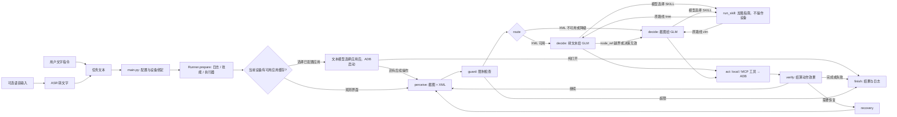

# Automotive GUI Agent

从零部署、拉通检测与运行监测见[部署与联调手册](../../doc/部署与联调手册.md)。

自检结果的含义见[部署与联调手册第 3 节](../../doc/部署与联调手册.md#3-设备和应用配置)，运行日志的查看方式见该手册第 5 节。

相关文档的位置如下，路径相对于项目根目录。

| 文档 | 相对于项目根目录的位置 | 要看的内容 |
|---|---|---|
| 部署与联调手册 | `doc/部署与联调手册.md` | 第 2 节部署、第 3 节自检、第 5 节日志 |
| 队伍分工说明 | `doc/队伍分工说明.md` | 团队分工 |

下文的源码链接相对于本 README 所在的 `server/autogui` 目录。比如 `autogui/core/graph.py` 在项目中的完整相对位置是 `server/autogui/autogui/core/graph.py`。

看懂车机屏幕、操作车机屏幕的 Agent。LangGraph 做决策大脑，MCP 做执行面，自研 ADB 桥接层直连
Android Automotive 中控屏。CART Q3 AI 大赛作品。

```
你：在音乐 App 里播放周杰伦的《七里香》
Agent：看屏幕 → 判断当前状态 → 选一个控件 → 点下去 → 确认屏幕变了 → 下一步 → 完成
全程不需要任何 App 的 API。
```

---

## 1. 快速上手（Windows / PowerShell）

电脑运行程序，通过 ADB 控制安卓设备；GLM 服务负责根据指令和屏幕信息决定下一步操作。手机可以检查技术链路，正式车机验收仍需使用中控主屏。

### 准备条件

| 需要 | 要求 |
|---|---|
| Python | 3.10 或更高版本 |
| ADB | 仓库自带 `env/platform-tools/adb.exe`，需加入当前窗口的 PATH |
| 安卓设备 | USB 调试已开启、已允许这台电脑调试，`adb devices -l` 状态为 `device` |
| 模型服务 | 电脑能访问配置的 GLM 服务，有可用的 URL、模型名称和 API Key；截图定位需要模型支持图像输入 |

不需要本地 GPU、Docker、Node、数据库或模型权重。文字任务无需麦克风和讯飞凭证。

### 第 1 步：设置路径并检查连接

打开 PowerShell，将第一行改成你电脑上的项目位置。后续命令都在这个窗口执行。

```powershell
$repo = 'D:\Workspace\github\automotiveGUI'
$env:Path = (Join-Path $repo 'env\platform-tools') + ';' + $env:Path
Set-Location (Join-Path $repo 'server\autogui')
py -3 -V
adb version
adb devices -l
```

`$repo` 保存项目路径，第二行让电脑和程序能找到 ADB，第三行进入程序目录。应看到 Python 3.10+、ADB 版本，以及状态为 `device` 的设备。如果没有 `py`，用 `python -V` 检查版本，后面的 `py -3` 也改成 `python`。连接异常的逐步处理见[部署手册第 2.1 节](../../doc/部署与联调手册.md#21-电脑与设备)。

### 第 2 步：安装依赖并自检

```powershell
py -3 -m venv .venv
.\.venv\Scripts\python.exe -m pip install -r requirements.txt
.\.venv\Scripts\python.exe main.py --selftest
.\.venv\Scripts\python.exe main.py --check
```

已有 `.venv` 时可跳过第一行。`--selftest` 运行离线测试，不需要设备或模型密钥；`--check` 需要设备，但不调用模型。自检中 `[✗]` 表示失败，需先处理；`[!]` 是警告，仍需核对。退出码为 `0` 只代表硬检查通过，详细判据见[部署手册第 3 节](../../doc/部署与联调手册.md#3-设备和应用配置)。

### 第 3 步：启动面板，配置模型和应用

```powershell
Set-Location $repo
.\server\autogui\.venv\Scripts\python.exe .\dist\dashboard_server.py
```

保持这个窗口打开，浏览器访问 [设置页](http://127.0.0.1:8777/settings)：

1. 填写模型 URL、名称和 API Key，点击“验证连接”，成功后保存。
2. 在应用配置中点击“重新加载”，取得当前设备的包名列表；为目标应用选择正确包名后保存。中文名称不能直接当作包名。
3. 打开[任务页](http://127.0.0.1:8777/)，输入一条结果容易确认的任务，例如“打开 QQ 音乐”（应用名称按设备实际安装情况替换）。

在设备屏幕上确认应用确实打开，再去[日志页](http://127.0.0.1:8777/logs)查看运行记录。按 `Ctrl+C` 停止服务。关闭窗口后，路径设置和环境变量不会自动保留。

API Key 在设置页保存时，会使用 Windows DPAPI 加密写入本机 `config.yaml`，换机器或 Windows 用户后需重新录入。也可以只用 CLI，通过环境变量提供 Key，方法见[部署手册第 2.3 节](../../doc/部署与联调手册.md#23-配置-glm-与语音凭证)。不要提交明文凭证或本机凭证配置。

### 使用 CLI 执行任务

如果面板仍在运行，另开 PowerShell，重新执行第 1 步的前三行，再运行：

```powershell
.\.venv\Scripts\python.exe main.py "打开 QQ 音乐"
$LASTEXITCODE
```

面板与 CLI 读取同一份配置。退出码为 `0` 后仍需确认屏幕上的实际结果。`--dump-report` 会依次启动配置中的应用，首次跑任务前不必执行；包名校准后再用它检查控件树质量。

`run.bat` 是可选的 CLI 入口，只负责安装依赖或调用任务命令。它不创建虚拟环境、不配置 ADB 或模型。若要让它使用上述虚拟环境，先在程序目录执行 `$env:PYTHON = (Resolve-Path '.\.venv\Scripts\python.exe').Path`，再执行 `.\run.bat check` 或 `.\run.bat "任务"`。

---

## 2. 架构



`route` 只选 tree/VLM。模型可以在 `decide` 中选择 `SKILL`，加载指南后再决定具体动作；普通指令不会因关键词而直接执行配方。完整条件边见源码 [`autogui/core/graph.py`](autogui/core/graph.py)。

主要实现边界：

1. **模型返回动作，执行层操作设备。** 常规动作经 `core/executor.py`、`bridge/tools.py` 执行；滚轮调整由 `core/picker.py` 配合设备桥接层完成。
2. **local 和 MCP 共用设备工具函数。** 这些函数会读取或操作设备。`exec_mode: local` 与 `mcp` 调用的是同一批函数，
   所以 MCP 集成出问题改一个配置就能跑，不会卡死主线。
3. **LangGraph 只管控制流。** 状态里只放路由要读的字段，截图/XML/上下文放在 Runner 上。

---

## 3. 定位路径（声明：**C**）

| | 通道 | 触发条件 | 决策请求内容 |
|---|---|---|---|
| 1 | **tree**（控件树 → 模型选 `node_ref`） | `uiautomator dump` 有 ≥3 个可寻址候选 | 控件候选文本，**不发图** |
| 2 | **vlm**（截图定位） | 树为空 / 自绘界面 / tree 返回越界 `node_ref` | 上下文和一张截图 |
| 可选 | **Skill 指南** | 模型选择合适技能且参数齐全 | 加载指南后再调用模型；不自动操作设备 |

运行时固定控件树优先、VLM 兜底，不提供 A/B/C 切换配置。`--dump-report` 用于检查各应用的树质量；赛事路径 C 声明以真实任务日志和演示证据支持。

截图定位使用没有网格覆盖的画面。模型返回截图上的像素坐标，程序按图像与设备屏幕尺寸换算后执行。tree 决策无效时会降级到 VLM；模型重试、加载 Skill 和反思可能增加调用次数，不能把一轮操作理解为固定只有一次请求。

### 滚动控件

- 普通列表用 `SCROLL(direction, node_ref?, amount?)`；指定 `node_ref` 时，手势落在该控件内，`amount` 是可滑动范围的 0.1～0.9。页面有多个滚轮时必须指定目标。
- XML 可读的整数 `NumberPicker` 用 `ROLL_TO(node_ref, target, delta_units?)`，例如目标 `19时`。模型选择目标并可填写当前值到目标值的差；执行器在滚轮内部短滑、重新读取数值并逐次修正，不采用固定的每格像素数。
- 达到目标值只表示滚轮读数正确；弹窗的“确定”和表单时间核验仍由后续决策完成。日期等无法解析成单个整数的控件，可用指定目标的 `SCROLL` 逐步观察。

---

## 4. 命令

在 `server/autogui` 目录执行。下表的 `python` 指安装过项目依赖的解释器；按第 1 节创建虚拟环境后，替换为 `.\.venv\Scripts\python.exe`。

| 命令                                                  | 作用 |
|-----------------------------------------------------|---|
| `python main.py "打开美团，搜索卡旺卡"`                       | 跑一个任务，实时打印决策链 |
| `python main.py --selftest`                         | 离线测试（无车机、无 Key） |
| `python main.py --check`                            | 车机自检：抓帧耗时/树节点/输入策略/**IME 未被改坏** |
| `python main.py --packages`                         | 列出安装的应用，用于填 `config.yaml` |
| `python main.py --dump-report`                      | 逐 App 实测控件树质量 → `artifacts/dump-report.md` |
| `python main.py --mcp-check`                        | 真开一个 MCP 会话，列工具 + 校验与 local 同源 |
| `python main.py --skill-only "music.play_song=七里香"` | 跳过模型直接跑配方（0 次 VLM） |
| `python -m autogui.mcp_server`                      | 作为 stdio MCP server 给外部客户端用 |
| `python -m autogui.mcp_server --list-tools`         | 打印工具名、字段名及说明；也需要已连接设备 |
| `python main.py --voice-test` | 只验证麦克风和讯飞识别，不操作设备 |
| `python main.py --voice` | 将识别出的文字作为任务执行，需要设备和模型 |

覆盖默认配置：`--exec-mode mcp`、`--config 路径`。语音功能需额外安装 `.\.venv\Scripts\python.exe -m pip install -e ".[voice]"` 并配置讯飞凭证，具体步骤见部署手册。

---

## 5. 怎样查看运行日志

控制台按阶段打印任务进度，JSONL 文件每行记录一个事件：

| 阶段 | 含义 |
|---|---|
| `setup` | 初始化任务与运行环境 |
| `perceive` | 获取截图和控件树 |
| `route` | 选择应用直启、控件树定位或截图定位 |
| `decide` | 模型决定下一步动作 |
| `skill` | 加载任务指导 |
| `act` | 执行动作 |
| `verify` | 检查动作结果 |
| `recovery` | 尝试从无进展或错误页面恢复 |
| `finish` | 输出任务结果和统计 |
| `error` / `glm_error` | 运行错误或模型请求错误 |

纯打开任务如果命中应用缓存并成功直启，可以直接结束，不一定经过全部阶段。模型报告成功后仍需在设备上核对结果。

日志位置由 `config.yaml` 的 `log_dir` 决定，相对路径以 `server/autogui` 为基准。当前仓库配置为 `artifacts/logs`；代码在该字段缺省时使用 `test/log`。面板日志页固定读取 `artifacts/logs`，使用面板时保持该路径。

`debug: true` 时，JSONL 旁会生成同名目录，保存截图、XML、候选与模型请求/响应。排查失败时对照动作前后的画面，判断是否定位错误、页面未加载完成或任务结果不符。日志可能包含账号和任务内容，分享前检查并脱敏。实际耗时、模型调用次数和 token 用量以本次运行日志为准。

---

## 6. 配置

全在 `config.yaml`，默认值见 `autogui/config.py`。常改的配置：

| 键 | 默认 | 什么时候改 |
|---|---|---|
| `exec_mode` | `local` | MCP 不通时留 `local`；要演示 MCP 时改 `mcp` |
| `image.max_side` / `image.jpeg_quality` | `1568` / `85` | 控制发给模型的截图尺寸和 JPEG 质量 |
| `agent.reflection` | `cheap` | `cheap` 在画面无明显变化时进一步检查；`always` 对符合条件的动作调用模型反思；`off` 跳过这部分动作效果检查 |
| `apps` | 见配置文件 | 设置页全量维护目标应用名称、包名和别名；`--check` 核对全部目标应用 |

`glm.model`、`glm.base_url` 和 API Key 必须对应实际可用的服务。配置文件中已有的值会覆盖代码默认值；不要把默认值当作当前机器的有效配置。
面板设置页 `http://127.0.0.1:8777/settings` 可填写模型 URL、名称和 API Key，单独验证连接；`--check` 不发模型请求。逐项自检说明见[部署与联调手册第 3 节](../../doc/部署与联调手册.md#3-设备和应用配置)。

普通任务只有在应用缓存与当前设备匹配、且有可直启应用时，才先发文本模型请求，选择应用 ID 和可选的 Skill 指导。纯打开任务直启成功后结束；复合任务继续抓屏和 XML。缓存不匹配、没有可用应用、模型选择观察或直启失败时，进入屏幕观测流程。该请求的统计计入 `initial_model` 和模型用量。

---

## 7. 故障排查

| 现象 | 原因 / 处理 |
|---|---|
| `no ADB device connected` | 先用 USB 连接，检查 `adb devices -l`，在设备上允许调试；无线连接需先确认设备已开启对应功能和端口 |
| `multiple devices connected` | `config.yaml` 里 `device_serial` 写死具体 serial |
| `GLM_API_KEY is not set` | 在面板设置页录入 API Key，或为启动任务的进程设置 `GLM_API_KEY`；新任务会重新读取配置 |
| `--check` 里「IME 未被改坏」✗ | 输入探测前后默认输入法不一致；先恢复原输入法，再自检。实现见 `autogui/bridge/input.py` |
| 截图拿到的不是中控屏 | 检查 `display_id` 并确认截图来自中控。PNG 签名裁剪只处理截图字节前的杂项，不能修正选错屏幕的问题 |
| 中文输入变成字母 | 查看输入策略和实际输入结果。ASCII 通道不能精确输入中文；程序会尝试屏幕键盘，不能用字母代替中文并当作成功 |
| 一直 `BACK` 到桌面 | 检查该页面 XML 候选及 VLM 降级日志，并修正动作或 Skill 指导 |
| 跑两步就 `no_progress` 停止 | 先对照截图、`act` 和 `verify` 检查动作是否生效；确认页面只是加载慢后，再考虑调整等待时间或无进展上限 |
| `GraphRecursionError` | 保存错误日志，检查是否反复决策或加载指导；当前递归上限按 `max_steps*8+20` 设置，单纯调小任务步数不能定位原因 |

---

## 8. 已知限制

- **单屏**。只操作中控屏（规则 4.2 强制），不支持多屏/副屏/仪表屏切换。
- **`uiautomator dump` 在自绘界面（SurfaceView/游戏化 UI）拿不到控件**，此时使用截图定位，效果需在实际设备上验证。
- **中文输入依赖车机是否允许 yadb/ADBKeyboard**。没有可用的中文输入通道时会尝试屏幕键盘，仍需核对实际输入；ASCII 通道不能代替中文。
- **无长期记忆**。上下文只在单次任务内有效，不做跨任务持久化。
- **不处理登录、支付、验证码**。规则不允许，也没做。
- **`estimate_tokens` 是启发式**，不是真 tokenizer，只用于决定裁剪多少；对外报告的是 GLM 返回的真实用量。
- **显式 `--skill-only` 配方的 hint 文本需在真机上实测填写**。仓库里现带的 `music`/`bilibili` 配方含占位文本；普通指令只读取 `guide`，不执行这些步骤。

---

## 9. 目录

```
server/autogui/
├── main.py                CLI（--check / --dump-report / --mcp-check / --selftest）
├── config.yaml            运行时配置
├── run.bat                Windows 一键入口
├── requirements.txt       无 uv 时的 pip 路径
├── autogui/
│   ├── actions.py         动作协议 + 严格校验
│   ├── config.py          pydantic 配置（不碰设备）
│   ├── bridge/
│   │   ├── adb.py         ADB 原语：exec-out/PNG裁剪/错误分级/防注入/树解析
│   │   ├── input.py       中文输入：IME 存复 + yadb→ADBKeyboard→ASCII 降级
│   │   └── tools.py       设备工具函数与 MCP 注册表
│   ├── mcp_server.py      FastMCP，把 tools 套成协议面
│   ├── perception/
│   │   ├── capture.py     并行抓帧 + 屏幕指纹
│   │   ├── tree.py        XML → 压缩候选（tree 模式不发图的底气）
│   │   └── image.py       截图缩放与 JPEG 编码
│   ├── brain/
│   │   ├── glm_client.py  配置的模型服务（OpenAI 兼容）+ JSON 校验 + 用量统计
│   │   ├── prompts.py     读取模板、填充动态字段、组装消息
│   │   ├── prompt_text.yaml  通用模型提示词（首次选应用/决策/反思/重试/上下文）
│   │   └── context.py     四层上下文 + token 预算裁剪
│   ├── core/
│   │   ├── graph.py       LangGraph 9 节点 + 条件回边
│   │   ├── picker.py      可读数值滚轮的调整与核验
│   │   ├── state.py       状态字段
│   │   ├── guard.py       三重硬限制
│   │   ├── decision_log.py 规则 4.7 决策链 + JSONL
│   │   └── executor.py    local / mcp 双通道
│   └── skills/
│       └── base.py        模型指南加载 + 显式配方执行器
├── skills/                App 指导与页面经验（<app>/skill.yaml、ui_hints.yaml）
└── tests/                 离线单测，不需要车机与网络
```

### 提示词维护

- 通用提示词集中在 [`autogui/brain/prompt_text.yaml`](autogui/brain/prompt_text.yaml)。`$task`、`$context_text`、`$width` 等占位符由代码填入；修改后重启服务生效。
- 动作名称、动作字段和滚动方向从 `actions.py` 生成，修改动作协议时以该文件为准，不在 YAML 中另维护一份列表。
- 应用任务指导维护在 `skills/<app>/skill.yaml`；仅在当前 XML 页面标记命中时发送的经验维护在 `skills/<app>/ui_hints.yaml`。
- 修改模板后运行 `python -m pytest tests -q`，并查看 debug 日志中的 `glm_request` 确认实际发送的文本。

### 应用包名缓存

设置页「重新加载」会从当前连接的设备重新取得安装包列表，只把页面维护的目标应用写入 `config.yaml.apps`，并记录 `app_cache_serial`。当前设备上不存在的旧包名会清空，应用名称和别名保留；包名列表只供选择，不会全量写入配置。中文应用名无法从 `pm list packages` 的英文包 ID 可靠反查，未补全的包名需要在设置页选择后保存。运行任务时，只有缓存序列号与当前设备一致才会用配置包名直接启动应用。

---

## 10. 参考与借鉴来源

以下借鉴关系在源码注释中有记录，对应实现入口如下：

- **LightGUIAgent**：提示词组织、日志和上下文等思路，见 [`brain/prompts.py`](autogui/brain/prompts.py)、[`core/decision_log.py`](autogui/core/decision_log.py)。
- **android-agent（Ghost in the Droid）**：ADB、文字输入和 MCP 工具注册的适配，见 [`bridge/adb.py`](autogui/bridge/adb.py)、[`bridge/input.py`](autogui/bridge/input.py)、[`mcp_server.py`](autogui/mcp_server.py)。
- **MobileAgent**：动作前后画面的反思提示与失败上下文保留思路，见 [`brain/prompts.py`](autogui/brain/prompts.py)、[`brain/context.py`](autogui/brain/context.py)。

---

## 11. 团队分工

见[队伍分工说明](../../doc/队伍分工说明.md)。
