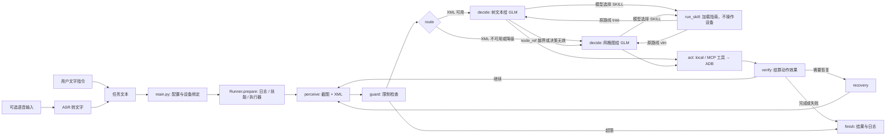

# Automotive GUI Agent

想按代码逐步理解 skill、XML、VLM 的切换和联调日志，请先读 [代码流程与联调日志导读](../../doc/代码流程与联调日志导读.md)。

看懂车机屏幕、操作车机屏幕的 Agent。LangGraph 做决策大脑，MCP 做执行面，自研 ADB 桥接层直连
Android Automotive 中控屏。CART Q3 AI 大赛作品。

```
你：在音乐 App 里播放周杰伦的《七里香》
Agent：看屏幕 → 判断当前状态 → 选一个控件 → 点下去 → 确认屏幕变了 → 下一步 → 完成
全程不需要任何 App 的 API。
```

---

## 1. 快速上手（目标 10 分钟内跑通）

### 依赖

| 需要 | 版本 | 说明 |
|---|---|---|
| Python | 3.10+ | 用到 `X \| None` 语法 |
| ADB | 任意新版 | Android Platform Tools，`adb version` 能跑即可 |
| 车机/安卓设备 | — | USB 调试已开，`adb devices` 能看到 |
| GLM API Key | 组委会发放 | 只走环境变量，不写进仓库 |

不需要：GPU、Docker、Node、数据库、模型权重。

### 步骤

```bash
# ① 依赖（二选一）
uv sync                                  # 有 uv：一条命令，锁版本
pip install -r requirements.txt          # 没 uv：纯 pip，同样可用

# ② Key（只从环境读，永远不进 git）
set GLM_API_KEY=xxxx                     # Windows cmd
$env:GLM_API_KEY="xxxx"                  # PowerShell
export GLM_API_KEY=xxxx                  # bash

# ③ 连车机
adb devices                              # 应看到一行 <serial>  device
# 无线连接：adb connect <车机IP>:5555

# ④ 先自检，不要一上来就跑任务
python main.py --selftest                # 不需要车机、不需要 Key
python main.py --check                   # 需要车机：抓帧/控件树/输入/IME 逐项打勾
```

前两步任意一步失败，看 [§7 故障排查](#7-故障排查)。

### 跑第一个任务

```bash
python main.py --packages                # 看车机上到底装了哪些包
#   → 把想用的包名填进 config.yaml 的 apps: [{name, package}]

python main.py --dump-report             # 实测各 App 控件树质量
#   → 生成 artifacts/dump-report.md，据此定 config 的 declared_path: A/B/C

python main.py "在音乐App里播放周杰伦的《七里香》"
```

Windows 用户可以全部用 `run.bat` 代劳：`run.bat setup` / `run.bat check` / `run.bat "任务"`。

---

## 2. 架构



`route` 只选 tree/VLM。模型可以在 `decide` 中选择 `SKILL`，加载指南后再决定具体动作；普通指令不会因关键词而直接执行配方。完整条件边见[代码流程与联调日志导读](../../doc/代码流程与联调日志导读.md)。

三条不可破的约束：

1. **大脑不直接碰 ADB。** 所有设备操作经 `bridge/tools.py`。节点里找不到一行 `subprocess`。
2. **工具本体是纯函数。** MCP 只是套 schema。`exec_mode: local` 与 `mcp` 调用的是同一批函数，
   所以 MCP 集成出问题改一个配置就能跑，不会卡死主线。
3. **LangGraph 只管控制流。** 状态里只放路由要读的字段，截图/XML/上下文放在 Runner 上。

---

## 3. 定位路径（声明：**C**）

| | 通道 | 触发条件 | 每次决策开销 |
|---|---|---|---|
| 1 | **tree**（控件树 → 模型选 `node_ref`） | `uiautomator dump` 有 ≥3 个可寻址候选 | 1 次，**纯文本，不发图** |
| 2 | **vlm**（网格截图） | 树为空 / 自绘界面 / tree 返回越界 `node_ref` | 1 次 + 1 张图 |
| 可选 | **Skill 指南** | 模型选择合适技能且参数齐全 | 加载指南后再调用模型；不自动操作设备 |

`declared_path` 是提交给评委的声明。规则 4.4 明确"声明与实际实现不符按实际给分"，所以这个值**必须
由 `python main.py --dump-report` 的实测结果决定**，不要手改 `config.yaml`。

降级是真实发生的代码路径，决策链里会打印 `tree 决策无效 → 本轮降级 vlm` 这样的行，供 AI Reviewer 核验。

---

## 4. 命令

| 命令                                                  | 作用 |
|-----------------------------------------------------|---|
| `python main.py "打开美团，搜索卡旺卡"`                       | 跑一个任务，实时打印决策链 |
| `python main.py --selftest`                         | 离线单测（无车机、无 Key），CI 门禁 |
| `python main.py --check`                            | 车机自检：抓帧耗时/树节点/输入策略/**IME 未被改坏** |
| `python main.py --packages`                         | 列出安装的应用，用于填 `config.yaml` |
| `python main.py --dump-report`                      | 逐 App 实测控件树质量 → `artifacts/dump-report.md` |
| `python main.py --mcp-check`                        | 真开一个 MCP 会话，列工具 + 校验与 local 同源 |
| `python main.py --skill-only "music.play_song=七里香"` | 跳过模型直接跑配方（0 次 VLM） |
| `python -m autogui.mcp_server`                      | 作为 stdio MCP server 给外部客户端用 |
| `python -m autogui.mcp_server --list-tools`         | 打印工具清单与 schema |

覆盖默认配置：`--exec-mode mcp`、`--path B`、`--config 路径`。

---

## 5. 决策链样例

规则 4.7 要求实时打印。真实一次运行的形状（`--path C`，Easy 任务）：

```
====================================================================
Automotive GUI Agent  |  路径 C  |  exec=local
====================================================================
  任务: 在音乐App里播放周杰伦的《七里香》
  设备: 192.168.1.37:5555
  技能: 3 个可用

[Step 1] perceive  1920×1080 树60节点/候选40 shot_ms=412 dump_ms=1180 sig=a3f9c1d2
[Step 1] route      tree（控件树可用：候选40）
[Step 1] decide     CLICK node_ref=3 "点击搜索框进入搜索" glms=1 in_tok=2841 out_tok=87
[Step 1] act        OK tap(960,72)
[Step 1] verify     指纹变化=是 → 继续（0 次 VLM） sig=7be0f4a1

[Step 2] perceive  1920×1080 树44节点/候选31 shot_ms=398 dump_ms=940 sig=7be0f4a1
[Step 2] route      tree（控件树可用：候选31）
[Step 2] decide     TYPE text='七里香' "输入歌名" glms=1 in_tok=2610 out_tok=94
[Step 2] act        OK input(yadb) sent='七里香'
[Step 2] verify     指纹变化=是 → 继续（0 次 VLM） sig=c2d8e5f0

[Step 5] perceive  1920×1080 树38节点/候选28 sig=f1a2b3c4
[Step 5] route      tree（控件树可用：候选28）
[Step 5] decide     CLICK node_ref=6 "点击搜索结果里的歌曲" glms=1 in_tok=2702 out_tok=79
[Step 5] act        OK tap(512,388)
[Step 5] verify     反思=C 未生效/进错页 → 恢复 vlm=1
[Step 5] recovery   第 1 级：press_back

[Step 7] decide     COMPLETE "七里香正在播放，播放条已高亮" glms=1 in_tok=2650 out_tok=61
[Step 7] verify     终止动作 COMPLETE vlm=0

────────────────────────────────────────────────────────────────────
结果 ✅ 成功   status=complete
────────────────────────────────────────────────────────────────────
  步数            7
  总耗时          41.2s   (平均 5.9s/步)
  GLM 调用次数    6   (反思额外 1 次)
  平均每步 VLM    0.86    ← 目标 ≤ 1（Mobile-Agent-v2 ≈ 4）
  token  in/out   16,841 / 512   合计 17,353
  路由分布        decide=5  tree=6
  决策链日志      artifacts\logs\在音乐App里播放-20260915-142201.jsonl
────────────────────────────────────────────────────────────────────
```

> 上面是**格式样例**，数值来自离线自检的形状，不是真机成绩。真机日志在借到车机后用
> `python main.py "..."` 重新生成并归档到 `artifacts/`。

每一行都对应评分项：`route` 行 = 路径 C 的证据；`verify` 行的 `0 次 VLM` = Context；
`shot_ms/dump_ms` = 性能；结尾统计 = 客观分自证。

---

## 6. 配置

全在 `config.yaml`，默认值见 `autogui/config.py`。最常改的四个：

| 键 | 默认 | 什么时候改 |
|---|---|---|
| `declared_path` | `C` | **只**按 `--dump-report` 结果改 |
| `exec_mode` | `local` | MCP 不通时留 `local`；要演示 MCP 时改 `mcp` |
| `grid.cols/rows` | `20/10` | 车机分辨率差异大时按 `--check` 里 cell 尺寸调 |
| `agent.reflection` | `cheap` | `always` 更准但每步多 1 次调用；`off` 最快但丢掉恢复 |

`glm.model` 需要换成组委会实际发的型号 id。

---

## 7. 故障排查

| 现象 | 原因 / 处理 |
|---|---|
| `no ADB device connected` | `adb devices`；无线则 `adb connect IP:5555`；车机上确认已允许调试 |
| `multiple devices connected` | `config.yaml` 里 `device_serial` 写死具体 serial |
| `GLM_API_KEY is not set` | 只认环境变量，见 §1 ②。注意设完要**重开**终端 |
| `--check` 里「IME 未被改坏」✗ | **不要继续**。说明输入法被换走了，中文输入会静默失败。见 `autogui/bridge/input.py` 的 `_via_adbkeyboard` |
| 截图拿到的不是中控屏 | 车机多屏，`screencap` 默认屏不对。已在 `bridge/adb.py` 用 `--display` 前的 PNG 签名裁剪兜底；仍错则设 `display_id` |
| 中文输入变成字母 | 正常——车机可能禁装 yadb/ADBKeyboard，自动降级到 ASCII。确认方式：`--check` 的「输入策略」 |
| 一直 `BACK` 到桌面 | 树不可用且在原地打转。临时用 `--path A` 走纯网格；或给该 App 补 skill 配方 |
| 跑两步就 `no_progress` 停止 | `agent.no_progress_limit` 调大；或该界面确实需要滑动，看决策链里 `route` 是否错判 |
| `GraphRecursionError` | 把 `agent.max_steps` 调小。递归上限按 `max_steps*6+20` 自动算 |

---

## 8. 已知限制

诚实清单，不掩饰：

- **单屏**。只操作中控屏（规则 4.2 强制），不支持多屏/副屏/仪表屏切换。
- **`uiautomator dump` 在自绘界面（SurfaceView/游戏化 UI）拿不到控件**，此时走网格兜底，准确率下降。
- **中文输入依赖车机是否允许 yadb/ADBKeyboard**。都禁则只剩 ASCII + 拼音，长中文搜索会退化。
- **无长期记忆**。上下文只在单次任务内有效，不做跨任务持久化。
- **不处理登录、支付、验证码**。规则不允许，也没做。
- **网格模式列标签单字母**，所以 `grid.cols ≤ 26`。横屏 20 列够用。
- **`estimate_tokens` 是启发式**，不是真 tokenizer，只用于决定裁剪多少；对外报告的是 GLM 返回的真实用量。
- **显式 `--skill-only` 配方的 hint 文本需在真机上实测填写**。仓库里现带的 `music`/`bilibili` 配方含占位文本；普通指令只读取 `guide`，不执行这些步骤。

---

## 9. 目录

```
autogui/
├── main.py                CLI（--check / --dump-report / --mcp-check / --selftest）
├── config.yaml            运行时配置
├── run.bat                Windows 一键入口
├── requirements.txt       无 uv 时的 pip 路径
├── autogui/
│   ├── actions.py         动作空间：11 个动作 + 严格校验
│   ├── config.py          pydantic 配置（不碰设备）
│   ├── bridge/
│   │   ├── adb.py         ADB 原语：exec-out/PNG裁剪/错误分级/防注入/树解析
│   │   ├── input.py       中文输入：IME 存复 + yadb→ADBKeyboard→ASCII 降级
│   │   └── tools.py       19 个纯函数 = MCP 工具本体
│   ├── mcp_server.py      FastMCP，把 tools 套成协议面
│   ├── perception/
│   │   ├── capture.py     并行抓帧 + 屏幕指纹
│   │   ├── tree.py        XML → 压缩候选（tree 模式不发图的底气）
│   │   └── grid.py        横屏网格 + 标注 + 动作标记
│   ├── brain/
│   │   ├── glm_client.py  GLM 5.3（OpenAI 兼容）+ JSON 严格 + 用量统计
│   │   ├── prompts.py     decide(tree/vlm) + reflect(A/B/C)
│   │   └── context.py     四层上下文 + token 预算裁剪
│   ├── core/
│   │   ├── graph.py       LangGraph 8 节点 + 条件回边
│   │   ├── state.py       窄状态
│   │   ├── guard.py       三重硬限制
│   │   ├── decision_log.py 规则 4.7 决策链 + JSONL
│   │   └── executor.py    local / mcp 双通道
│   └── skills/
│       └── base.py        模型指南加载 + 显式配方执行器
├── skills/                配方的实际存放处（<app>/skill.yaml），与同名包分开
└── tests/                 离线单测，不需要车机与网络
```

---

## 10. 参考与借鉴来源

本项目不是从零到一，也不是拿现成套壳。借了什么、改了什么，逐条登记在
[`../技术方案评估.md`](../技术方案评估.md) §8，源码注释里也标注了来源文件与行号。

- **LightGUIAgent** — 闭环骨架、网格坐标思路、JSON 解析校验、JSONL 日志结构。
- **android-agent（Ghost in the Droid）** — ADB 封装范式、错误分级、控件树解析全家桶、Skill 声明式结构与弹窗三级策略、FastMCP 工具注册范式。
- **MobileAgent（阿里 X-PLUG）** — 仅设计思想：反思 A/B/C、进度与实体记忆分层。代码与模型均未使用。

三者的适配点与**已在哪些地方必须改掉**，同样记在该文档 §2。

---

## 11. 团队分工

见 [`../aidoc/`](../aidoc/) 与提交时的 `队伍分工说明`（交付物 7）。
